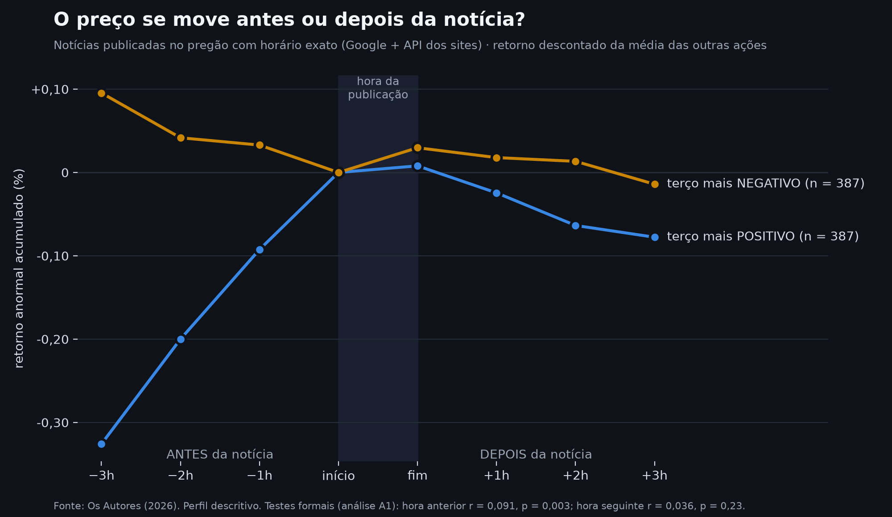

# InvestAI — sentimento de notícias × retorno de ações na B3

Estudo estatístico que testa se o tom das notícias sobre uma empresa se
relaciona com o retorno da sua ação na B3 e, principalmente, **quem vem
primeiro: a notícia ou o preço**.

> Trabalho acadêmico de conclusão de curso técnico, apresentado na
> MOSTRATEC-LIBERATO 2026 (Ciências da Computação). **Não é recomendação de
> investimento.**

Leonardo Kohn e Maurício Renck Gedrat · Orientador: Prof. Raul Mesquita
Fundação Escola Técnica Liberato Salzano Vieira da Cunha · 2026

O relatório completo da pesquisa fica em [`docs/mostratec/`](docs/mostratec/).

---

## Resultado em uma frase

**A manchete chega depois do preço.** O sentimento das notícias se associa ao
retorno da ação no mesmo dia, a associação é da própria empresa e se repete em
outro período e em ações menores, mas o preço se move antes da notícia, e a
notícia não antecipa o movimento seguinte. O resultado é coerente com a
hipótese de eficiência de mercado na forma semiforte (Fama, 1970).

## Principais números

**1. Existe associação no mesmo dia** (18.463 notícias, 8 ações, jan/2024 a set/2026):

| Ativo | n | r D−1 | p D−1 | r D+0 | p D+0 | r D+1 | p D+1 |
|---|---:|---:|---:|---:|---:|---:|---:|
| ABEV3 | 462 | 0,065 | 0,162 | 0,064 | 0,169 | 0,079 | 0,091 |
| BBDC4 | 657 | 0,028 | 0,480 | **0,101** | **0,010** | −0,002 | 0,957 |
| ITUB4 | 551 | −0,018 | 0,679 | 0,054 | 0,205 | 0,013 | 0,766 |
| MGLU3 | 512 | 0,040 | 0,370 | **0,161** | **< 0,001** | −0,030 | 0,494 |
| PETR4 | 650 | **0,118** | **0,003** | **0,144** | **< 0,001** | −0,023 | 0,553 |
| SUZB3 | 349 | **0,143** | **0,008** | **0,142** | **0,008** | −0,015 | 0,777 |
| VALE3 | 583 | 0,059 | 0,156 | **0,197** | **< 0,001** | 0,036 | 0,391 |
| WEGE3 | 367 | **0,149** | **0,004** | **0,196** | **< 0,001** | 0,049 | 0,346 |

No mesmo pregão (D+0), 6 de 8 ativos rejeitam H₀; no dia seguinte (D+1),
nenhum. Em negrito, p < 0,05 (p-valores clássicos; os de permutação levam às
mesmas conclusões em D+0).

**2. A associação resiste aos controles e se repete:**

| Teste | Resultado |
|---|---|
| Retorno anormal (descontado o Ibovespa) | r = 0,109; p = 0,0001 |
| Placebo: própria empresa × outras empresas | r = 0,112 × −0,003 |
| Sem as manchetes que só relatam o preço | r = 0,073; p = 0,0001 |
| Réplica em out/2021 a dez/2023 | r = 0,077; p de Holm = 0,002 |
| Réplica em 8 small caps | r = 0,213; p de Holm = 0,0004 |

**3. A direção é preço → notícia** (horário exato de 4.998 notícias):

| Teste | r | p | n |
|---|---:|---:|---:|
| Pregão encerrado → notícia da noite | 0,083 | 0,001 | 1.642 |
| Hora anterior → notícia do pregão | 0,091 | 0,003 | 1.155 |
| Notícia da noite → abertura seguinte | 0,013 | 0,59 | 1.642 |
| Notícia do pregão → hora seguinte | 0,036 | 0,23 | 1.159 |

Com barras de 1 e de 5 minutos, nenhum teste foi significativo nos dois
sentidos.



---

## Como o estudo foi feito

- **Notícias:** Google Notícias (RSS), por empresa, com filtro de confirmação;
  29.160 manchetes únicas somando todas as amostras.
- **Preços:** Yahoo Finance (diários, 60, 5 e 1 minuto) e Ibovespa.
- **Sentimento:** léxico financeiro em português com 266 termos, negação,
  intensificadores e atenuadores; o FinBERT-PT-BR foi usado como verificação.
- **Horário exato:** agregador (notícias recentes) e API pública dos sites
  WordPress, com filtro de data; 94% de concordância em 100 casos.
- **Estatística:** correlação de Pearson, p-valor por permutação (10.000
  repetições, semente fixa), correção de Holm e menor efeito detectável
  declarado em cada teste.
- **Validação prévia:** 1.000 séries simuladas, com 100% de detecção quando o
  efeito existe e 5,0% de falsos positivos quando não existe.
- **Pré-registro:** a partir de 28/09/2026, cada rodada de testes foi escrita
  antes de rodar (10 pré-registros e 4 adendos em [`docs/`](docs/)).

## Limitações declaradas

- Efeitos menores que o limite de detecção de cada teste não podem ser
  descartados: "não detectado" não significa "zero".
- O léxico teve concordância apenas razoável com os rótulos de referência
  preliminares (kappa de 0,30); a rotulagem humana às cegas está em andamento.
- A associação das notícias do pregão com a hora anterior não se manteve com o
  FinBERT-PT-BR.
- Só a manchete é analisada, as notícias vêm de um único agregador e não há
  preços abaixo de 1 minuto.
- O estudo é observacional: estabelece precedência temporal, não causalidade.

## Próximos passos

1. Coleta diária prospectiva, iniciada em 02/10/2026, com regra de parada
   fixada antes: 1.500 eventos ou 30/06/2027.
2. Rotulagem humana das 300 manchetes da validação, feita às cegas pelos dois
   autores.
3. Fatos relevantes da CVM, que têm horário oficial de entrega, como evento
   de referência.

---

## Como verificar os resultados

Qualquer pessoa pode refazer **todos** os testes do estudo e conferir que os
números batem com os publicados:

    python verificacao/verificar_tudo.py        (no Windows: VERIFICAR_TUDO.bat)

O verificador confere a impressão digital (SHA-256) dos 75 arquivos de dados
congelados, roda as 32 etapas de análise sem internet e com o relógio fixado
em 02/10/2026, e compara cada saída com a referência. Última execução no
Windows, em 10/10/2026: **99 de 99 saídas conferem**
([relatório](verificacao/relatorio_verificacao_windows_2026-10-10.txt)).

O passo a passo está em [`REPRODUZIR.md`](REPRODUZIR.md); a explicação do
método, em [`docs/metodo_cientifico_e_verificacao.md`](docs/metodo_cientifico_e_verificacao.md).
Todos os testes feitos, inclusive os nulos, estão em
[`verificacao/registro_de_testes.csv`](verificacao/registro_de_testes.csv).

## Sobre os dados

O repositório **não** inclui o texto das notícias coletadas (conteúdo de
terceiros) nem as séries de preços do Yahoo Finance. O que fica versionado são
o código, as figuras, as tabelas de resultado e os rótulos de sentimento da
validação do léxico (só id e rótulo, sem o texto). Rodando os scripts de
coleta, os dados são reconstruídos, mas não idênticos, porque as fontes mudam
com o tempo. Para conferir os resultados exatamente, use o pacote de dados
congelados, entregue pelos autores a quem pedir.

## Como rodar

```bash
python -m venv venv
venv\Scripts\activate        # Windows
pip install -r requirements.txt
streamlit run dashboard.py
```

O painel abre no navegador e mostra **todos os resultados** do estudo, na
ordem das perguntas da pesquisa, em 8 páginas:

| Página | O que mostra |
|---|---|
| Início | a pergunta, a resposta em uma frase e os números principais |
| Como medimos o sentimento | o léxico ao vivo: digite uma manchete e veja a conta, termo a termo |
| O método foi testado antes | validação com dados sintéticos, poder do teste e um simulador de permutação |
| 1 · Existe relação? | resultado por ação (D−1, D+0, D+1), curva de defasagem e permutação |
| 2 · A relação é real? | retorno anormal, placebo entre empresas, réplicas e os testes nulos |
| 3 · Quem vem primeiro? | os testes de direção, o perfil hora a hora e o minuto a minuto |
| Explorar os dados | as notícias e os preços de cada ação, com a correlação calculada na hora |
| Verificação e transparência | impressões digitais, verificador, registro de testes e pré-registros |

Os números vêm da referência do verificador (`verificacao/referencia/`), a
mesma do relatório: nenhum é digitado à mão. Com o pacote de dados congelados
em `verificacao/`, o painel também **refaz as contas ao vivo** (resultado por
ação, 80.000 embaralhamentos, impressões digitais e o próprio verificador) e
mostra que elas dão os mesmos números. Sem o pacote, as páginas de resultados
continuam funcionando.

**FinBERT ao vivo (opcional).** Na página do sentimento dá para comparar o léxico com o
FinBERT-PT-BR em qualquer manchete digitada. No Windows, rode uma vez o
`TESTAR_FINBERT.bat`: ele cria um ambiente separado (`venv_finbert`, com Python 3.12
e o torch CPU), testa o modelo contra os escores do estudo e não mexe no `venv`
principal. Depois, reinicie o painel.

Os scripts do estudo ficam em [`scripts/`](scripts/), numerados na ordem em
que os experimentos foram feitos; o cabeçalho de cada um explica o que ele faz
e qual pré-registro segue.

## Estrutura

```
InvestAI/
├── dashboard.py              painel do estudo (Streamlit)
├── paginas/                  as 8 páginas do painel
├── modulos/
│   ├── coleta/               notícias (RSS) e preços (yfinance, com cache local)
│   └── analise/              léxico, testes, retorno anormal, horários e minuto a minuto
├── scripts/                  os experimentos, numerados, e os scripts de coleta
├── testes/                   teste automático do alinhamento de datas
├── docs/                     pré-registros, protocolo, método, diário e literatura
│   └── mostratec/            entregas da feira: relatório, plano de pesquisa e vídeo
├── resultados/               figuras e tabelas geradas
├── verificacao/              verificador, manifesto SHA-256, referência e registro de testes
└── dados/                    dados locais (não versionados)
```

## Histórico

A versão apresentada na FEICIT 2026 incluía também um módulo de análise de
risco de carteiras (volatilidade, beta, VaR, Markowitz e um classificador de
perfil). Ele foi removido em 28/09/2026: não era objeto do estudo, e decisões
como o score 60/40 não tinham referência que as sustentasse. Esse código
continua acessível no histórico, na tag `feicit-2026`.

## Uso de inteligência artificial

Os autores usaram ferramentas de IA generativa, principalmente o assistente
Claude (Anthropic), na escrita de código e de textos e como anotador
preliminar na validação do léxico. Os números vêm dos scripts de análise e
podem ser refeitos pelo verificador. A declaração completa está no apêndice B
do relatório.

## Referências principais

- FAMA, E. F. Efficient capital markets: a review of theory and empirical work.
  *The Journal of Finance*, v. 25, n. 2, p. 383–417, 1970.
- GRANGER, C. W. J. Investigating causal relations by econometric models and
  cross-spectral methods. *Econometrica*, v. 37, n. 3, p. 424–438, 1969.
- MACKINLAY, A. C. Event studies in economics and finance. *Journal of Economic
  Literature*, v. 35, n. 1, p. 13–39, 1997.
- TETLOCK, P. C. Giving content to investor sentiment: the role of media in the
  stock market. *The Journal of Finance*, v. 62, n. 3, p. 1139–1168, 2007.
- SANTOS, L. L.; BIANCHI, R. A. C.; COSTA, A. H. R. FinBERT-PT-BR: análise de
  sentimentos de textos em português do mercado financeiro. In: BRAZILIAN
  WORKSHOP ON ARTIFICIAL INTELLIGENCE IN FINANCE, 2., 2023, João Pessoa.
  *Anais* [...]. Porto Alegre: SBC, 2023. p. 144–155.

A lista completa, em ABNT, está no relatório.

## Licença

MIT — ver [LICENSE](LICENSE).
