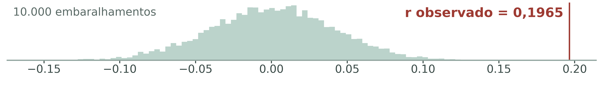
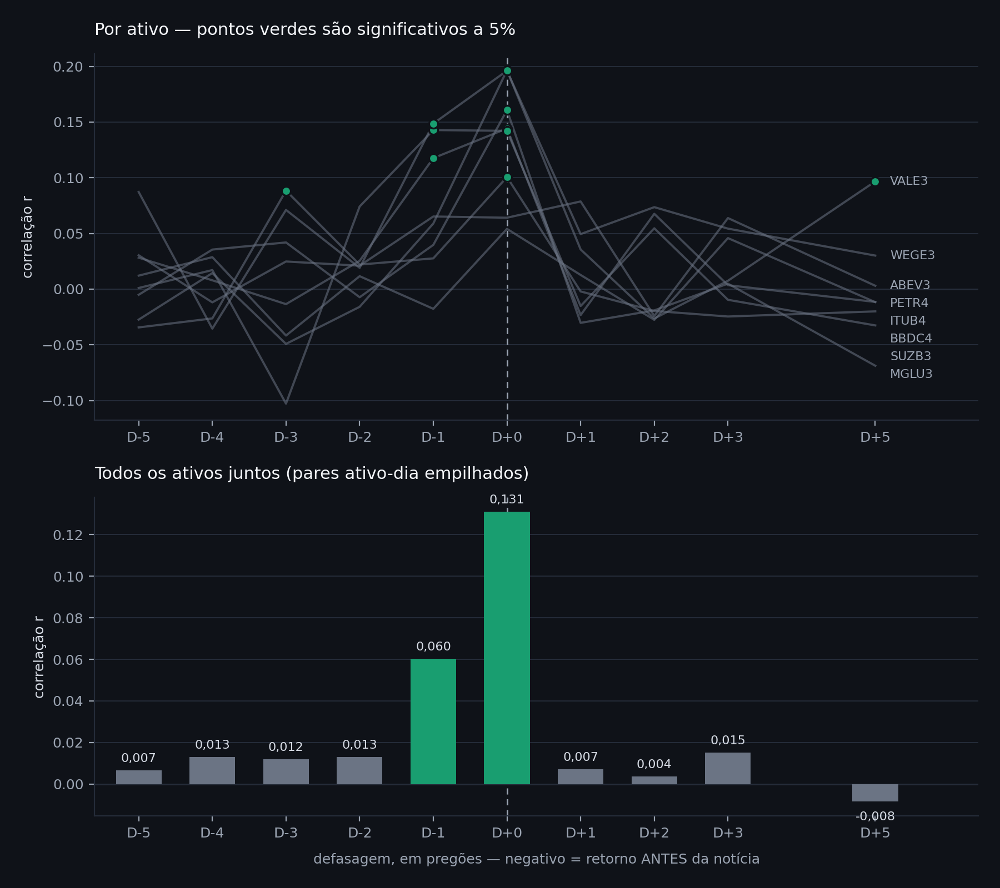

# InvestAI — sentimento de notícias × retorno de ações na B3

Estudo estatístico que testa se o tom das notícias sobre uma empresa se
relaciona com o retorno da sua ação — e em qual defasagem essa relação
aparece.

> Trabalho acadêmico de conclusão de curso técnico. **Não é recomendação de
> investimento.** O estudo mede associação entre variáveis; não estabelece
> causalidade nem prevê preços.

Leonardo Kohn e Maurício Renck Gedrat · Orientador: Prof. Raul Mesquita
Fundação Escola Técnica Liberato Salzano Vieira da Cunha · 2026

---

## Resultado

19.410 notícias · 8 ações de 7 setores · 32 meses (2024–2026) · α = 0,05
fixado antes da coleta.

| Ativo | n | r (D+0) | p (D+0) | H₀ em D+0 | r (D+1) | p (D+1) | H₀ em D+1 |
|---|---:|---:|---:|:--|---:|---:|:--|
| ABEV3 | 462 | 0,0641 | 0,1689 | não rejeita | 0,0404 | 0,3867 | não rejeita |
| BBDC4 | 657 | 0,1006 | 0,0099 | **rejeita** | −0,0048 | 0,9023 | não rejeita |
| ITUB4 | 551 | 0,0541 | 0,2048 | não rejeita | 0,0012 | 0,9784 | não rejeita |
| MGLU3 | 512 | 0,1607 | 0,0003 | **rejeita** | −0,0268 | 0,5462 | não rejeita |
| PETR4 | 650 | 0,1442 | 0,0002 | **rejeita** | −0,0384 | 0,3284 | não rejeita |
| SUZB3 | 349 | 0,1421 | 0,0078 | **rejeita** | −0,0613 | 0,2540 | não rejeita |
| VALE3 | 583 | 0,1965 | 0,0000 | **rejeita** | 0,0376 | 0,3649 | não rejeita |
| WEGE3 | 367 | 0,1961 | 0,0002 | **rejeita** | 0,0765 | 0,1440 | não rejeita |

**No mesmo pregão (D+0): 6 de 8 rejeitam H₀**, com p médio de 0,0031 entre os
significativos, e os seis vêm de seis setores diferentes.
**No dia seguinte (D+1): 0 de 8.**

O sentimento anda junto com o preço, mas não anda na frente — resultado
coerente com a hipótese de eficiência de mercado em sua forma semiforte.

### Controle negativo: o resultado sobrevive ao acaso?

O sentimento foi embaralhado entre os dias 10.000 vezes (semente 42), o que
destrói o pareamento notícia–dia e mostra quanta correlação aparece só por
sorte. Nos 8 ativos, o p empírico da permutação concordou com o p da fórmula.
Na VALE3, nenhum dos 10.000 embaralhamentos alcançou o valor observado.



### Controle de causalidade reversa (D−1)

Se o sentimento de hoje se associa ao retorno de **ontem**, parte da relação
observada pode ser o noticiário reagindo a um movimento que já aconteceu. Esse
teste foi pré-registrado (`docs/pre-registro_2026-09-28_defasagem-negativa.md`)
e rodado em 28/09/2026.

| Ativo | r em D−1 | p | r em D+0 | p | D+0 > D−1? |
|---|---:|---:|---:|---:|:--|
| ABEV3 | 0,0652 | 0,1620 | 0,0641 | 0,1689 | não |
| BBDC4 | 0,0276 | 0,4799 | 0,1006 | 0,0099 | não |
| ITUB4 | −0,0177 | 0,6787 | 0,0541 | 0,2048 | não |
| MGLU3 | 0,0397 | 0,3703 | 0,1607 | 0,0003 | não |
| PETR4 | **0,1176** | **0,0027** | 0,1442 | 0,0002 | não |
| SUZB3 | **0,1428** | **0,0076** | 0,1421 | 0,0078 | não |
| VALE3 | 0,0589 | 0,1555 | 0,1965 | 0,0000 | **sim** (p = 0,0165) |
| WEGE3 | **0,1486** | **0,0043** | 0,1961 | 0,0002 | não |

**O controle não passou limpo, e isso está reportado.** O sentimento se associa
ao retorno do pregão anterior em 3 dos 8 ativos. E, comparando as duas
correlações diretamente — pelo teste de Williams para correlações dependentes,
que leva em conta a autocorrelação do retorno —, a associação em D+0 só é
estatisticamente maior que a de D−1 na VALE3.

Na SUZB3 as duas são praticamente idênticas (0,1421 contra 0,1428): ali a
hipótese de cobertura reagindo ao preço explica o dado tão bem quanto a
hipótese contrária.

Duas ressalvas, nas duas direções:

- Não encontrar diferença **não** é o mesmo que provar que elas são iguais: com
  amostras desse tamanho, o teste tem pouco poder para separar correlações
  próximas. O caso da SUZB3, em que os valores coincidem, é diferente dos
  demais.
- Em 5 dos 8 ativos o D−1 não é significativo, então o padrão não é geral.

**O que isso muda no trabalho:** a conclusão sobre D+0 continua sendo de
associação — nunca foi de causa —, mas agora o estudo sabe e declara que, para
parte da amostra, a ordem temporal entre notícia e preço não está estabelecida.
É exatamente o que o próximo experimento ataca: os Fatos Relevantes da CVM têm
horário oficial de protocolo, o que permite separar o que veio antes do que
veio depois.

### A curva de defasagem: o efeito aparece antes da notícia?

Se a informação vazasse aos poucos antes da publicação, a correlação deveria
crescer gradualmente de D−5 até D+0. Se fosse cobertura reagindo ao preço,
apareceria um pico isolado logo antes. O teste foi pré-registrado
(`docs/pre-registro_2026-09-28_curva-de-defasagem.md`) com essa leitura
definida de antemão.



Com todos os pares ativo-dia empilhados:

| D−5 | D−4 | D−3 | D−2 | D−1 | D+0 | D+1 | D+2 | D+3 | D+5 |
|---:|---:|---:|---:|---:|---:|---:|---:|---:|---:|
| 0,007 | 0,013 | 0,012 | 0,013 | **0,060** | **0,131** | 0,007 | 0,004 | 0,015 | −0,008 |

O padrão é **um pico em D+0 com um ombro em D−1**, e nada em torno: de D−5 a
D−2 as correlações ficam entre 0,007 e 0,013, e a partir de D+1 voltam a zero.

Pelo critério escrito antes de rodar, isso **não** é o formato de vazamento
gradual de informação: não há decaimento ao longo de vários dias. É compatível
com uma janela curta — de horas a um pregão — em que preço e notícia se movem
juntos, seja porque o mercado se antecipou pouco antes, seja porque a cobertura
saiu logo depois do movimento. Com dado diário, as duas explicações produzem o
mesmo desenho.

Dois pontos isolados aparecem significativos longe do centro (BBDC4 em D−3,
VALE3 em D+5). Com 80 testes a 5%, quatro falsos positivos são o esperado, e
o pré-registro já dizia que a leitura seria do formato da curva, não de pontos
soltos.

---

## Como o estudo foi feito

- **Hipótese e α escritos antes da coleta** (06/08/2026, no caderno de campo),
  com as duas defasagens já previstas: mesmo pregão e dia seguinte.
- **Unidade de medida:** a notícia — cada manchete recebe um escore sozinha.
  **Unidade de análise:** o par ativo-dia, porque o retorno só existe por
  pregão.
- **Amostra por critério anotado antes de rodar:** no máximo 2 ativos por
  setor, porque empresas do mesmo setor não são casos independentes.
- **Mínimo de 60 observações por ativo**, derivado de análise de poder
  (com 20 observações o poder era de 32%; com 60 passa de 80%, convenção de
  Cohen, 1988) — não é número arbitrado.
- **Validação do módulo estatístico:** 1.000 simulações com dados sintéticos
  de resposta conhecida — 100% de detecção com efeito presente e 5,0% de
  falso positivo sem efeito, igual ao α adotado. A correlação prevista
  analiticamente (0,3592) bateu com a medida (0,3599).
- **Controle negativo:** teste de permutação com 10.000 embaralhamentos.

## Limitações declaradas

- **95,7% dos horários das notícias vêm normalizados pela fonte.** Sem hora
  real não é possível determinar se a notícia precedeu ou sucedeu o movimento
  do preço. Por isso o trabalho afirma associação, e não causa.
- **O léxico não foi validado contra rotulagem humana.** O que foi validado
  foi o método estatístico, não o instrumento de medida.
- **O que se mede é o tom (polaridade) da cobertura jornalística.** Não é o
  sentimento do investidor: ninguém foi entrevistado e nenhuma emoção foi
  registrada. "Sentimento do investidor" é um construto distinto na literatura
  (Baker e Wurgler, 2007), medido por pesquisas de opinião, fluxo de capital e
  indicadores de mercado. O termo "análise de sentimento" é mantido por ser o
  nome consagrado da técnica — é como o método aparece na literatura e nos
  modelos da área —, mas o objeto medido aqui é o texto, não a pessoa. A
  distinção foi apontada por um professor de psicologia e administração durante
  a FEICIT 2026.

## Próximos passos

1. ~~Teste de defasagem negativa (D−1)~~ — feito em 28/09/2026, resultado acima.
2. Backtest honesto da estratégia com sinal de D+1, contra buy-and-hold e com
   custos — a expectativa, dado o resultado acima, é que não supere.
3. Notícias por setor como segunda variável: o que move o preço, a notícia da
   empresa ou o clima do setor?
4. Fatos Relevantes da CVM, que têm horário oficial de protocolo — é o caminho
   para atacar a limitação principal.
5. Validação do léxico com 200 manchetes rotuladas à mão (kappa de Cohen) e
   comparação com o FinBERT-PT-BR.

---

## Como rodar

```bash
python -m venv venv
venv\Scripts\activate        # Windows
pip install -r requirements.txt
streamlit run dashboard.py
```

Scripts do estudo, a partir da pasta `InvestAI/`:

| Script | O que faz |
|---|---|
| `scripts/1_validar_modulo_estatistico.py` | Valida o módulo com dados sintéticos (1.000 simulações) |
| `scripts/2_coletar_e_analisar.py` | Coleta notícias e preços e calcula o sentimento |
| `scripts/7_curvas_de_deteccao.py` | Curvas de poder estatístico por tamanho de amostra |
| `scripts/9_teste_fim_de_semana.py` | Tentativa de contornar a limitação de horário |
| `scripts/12_teste_permutacao.py` | Controle negativo: 10.000 permutações por ativo |
| `scripts/13_defasagem_negativa.py` | Controle de causalidade reversa: sentimento x retorno de D−1 |
| `scripts/14_curva_de_defasagem.py` | Curva de defasagem de D−5 a D+5 |
| `scripts/15_diagnostico_cvm.py` | Verifica se os fatos relevantes da CVM têm horário e amostra suficiente |
| `scripts/16_impacto_fuso.py` | Mede o efeito do bug de fuso horário no resultado |
| `scripts/17_fim_de_semana_agrupado.py` | Teste de causalidade pelo calendário, com os ativos agrupados |
| `scripts/18_coletar_periodo_anterior.py` | Coleta as notícias de out/2021 a dez/2023 |
| `scripts/19_sem_manchetes_de_preco.py` | Teste de direção 1: refaz o D+0 sem as manchetes que relatam a cotação |
| `scripts/20_placebo_entre_empresas.py` | Teste de direção 2: sentimento de uma empresa contra o retorno de outra |
| `scripts/21_retorno_anormal.py` | Teste de direção 3: retorno descontado do Ibovespa |
| `scripts/22_granger.py` | Teste de direção 5: Granger nos dois sentidos |
| `scripts/23_baixar_intradiario.py` | Baixa as barras de 60 minutos do Yahoo |
| `scripts/24_horarios_wordpress.py` | Busca o horário oficial de publicação na API WordPress dos sites |
| `scripts/25_fase_causal.py` | Fase causal: abertura x pregão e hora a hora, com horários exatos |
| `scripts/26_grafico_perfil_horario.py` | Gráfico do retorno em volta da hora da notícia |
| `scripts/27_exploratorio_pos_resultado.py` | Análises exploratórias, decididas depois dos resultados |
| `scripts/28_amostra_validacao_lexico.py` | Sorteia (ou confere) as 300 manchetes da validação do léxico |
| `scripts/29_validacao_lexico.py` | Compara o léxico com os rótulos dos anotadores |
| `scripts/30_sentimento_modelos.py` | Escores do FinBERT-PT-BR e do distilbert para todas as manchetes |
| `scripts/30a_baixar_modelos.py` | Baixa os arquivos dos modelos do Hugging Face (não precisa do torch) |
| `scripts/31_baixar_minuto.py` | Barras de 1 e 5 minutos do Yahoo (acrescenta, nunca apaga) |
| `scripts/32_coletar_recentes.py` | Notícias recentes e horário oficial do WordPress |
| `scripts/33_smallcaps.py` | Seleção (carteira do SMLL + sorteio) e coleta das small caps |
| `scripts/34_coleta_diaria.py` | Coleta prospectiva diária (agendada pelo `AGENDAR_COLETA_DIARIA.bat`) |
| `scripts/35_validacao_modelos.py` | Léxico x modelos de linguagem contra os rótulos |
| `scripts/36_resultado_original_medida.py` | Resultado original (D−1, D+0, D+1) com cada medida |
| `scripts/37_piloto_minuto.py` | Piloto de minuto: 30 min antes e depois da notícia |
| `scripts/38_smallcaps_testes.py` | Testes H1 a H4 nas small caps |
| `scripts/39_resumo_fase_F.py` | Tabela léxico x FinBERT e exploratório das manchetes de relato |
| `scripts/40_janelas_curtas.py` | Janelas de até 5 minutos em volta da notícia (barras de 1 min) |
| `scripts/41_grafico_perfil_minuto.py` | Gráfico do perfil minuto a minuto, de −15 a +15 min |
| `scripts/congelar_resultados.py` | Recalcula o resultado a partir dos dados locais — teste de regressão do estudo |
| `scripts/diagnostico_ativos.py` | Mostra por que um ativo entrou ou ficou fora da análise |

## Estrutura

```
InvestAI/
├── dashboard.py              aplicação Streamlit — só o estudo
├── modulos/
│   ├── coleta/               notícias (RSS) e preços (yfinance, com cache local)
│   └── analise/
│       ├── sentimento.py     léxico de 300 termos, com negação e intensificadores
│       ├── hipotese.py       testes estatísticos do estudo
│       ├── avaliacao.py      retorno acumulado, drawdown e Sharpe (para o backtest)
│       ├── fuso.py           horário das notícias convertido para Brasília
│       ├── filtro_relato.py  marca manchetes que só relatam a cotação
│       ├── painel.py         teste agrupado (8 ativos), permutação em blocos de data
│       ├── mercado.py        Ibovespa e retorno anormal
│       ├── causal.py         fase causal: abertura x pregão e barras horárias
│       ├── validacao_lexico.py  léxico x rótulos dos anotadores (Fase E)
│       ├── horarios.py       horário exato: Google real ou WordPress com filtro de data
│       ├── modelos.py        escores dos modelos de linguagem (Fase F)
│       └── minuto.py         barras de 1 e 5 minutos e eventos com horário exato
├── scripts/                  os experimentos, numerados
├── docs/                     pré-registros, literatura e diário da causalidade
├── resultados/               figuras e tabelas geradas
└── dados/                    dados locais (não versionados)
```

## Sobre os dados

O repositório **não** inclui o texto das notícias coletadas (conteúdo de
terceiros) nem as séries de preços do Yahoo Finance. O que fica versionado são
o código, as figuras, as tabelas de resultado e os rótulos de sentimento da
validação do léxico (só id e rótulo, sem o texto). Rodando os scripts de coleta,
os dados são reconstruídos.

## Histórico

A versão apresentada na FEICIT 2026 incluía também um módulo de análise de
risco de carteiras (volatilidade, beta, VaR, Markowitz e um classificador de
perfil). Ele foi removido em 28/09/2026: não era objeto do estudo, e decisões
como o score 60/40 não tinham referência que as sustentasse. Esse código
continua acessível no histórico, na tag `feicit-2026`.

## Referências

- FAMA, E. F. Efficient capital markets: a review of theory and empirical work.
  *The Journal of Finance*, v. 25, n. 2, p. 383–417, 1970.
- SOUZA, D. M. S. de; MARTINS, O. S. Brazilian stock market performance and
  investor sentiment on Twitter. *Revista de Gestão*, v. 31, n. 1, p. 18–33,
  2024. DOI: 10.1108/REGE-07-2021-0145.
- COHEN, J. *Statistical power analysis for the behavioral sciences*. 2. ed.
  Hillsdale: Lawrence Erlbaum, 1988.
- BAKER, M.; WURGLER, J. Investor sentiment in the stock market. *Journal of
  Economic Perspectives*, v. 21, n. 2, p. 129–151, 2007.
- STEIGER, J. H. Tests for comparing elements of a correlation matrix.
  *Psychological Bulletin*, v. 87, n. 2, p. 245–251, 1980.

## Licença

MIT — ver [LICENSE](LICENSE).
